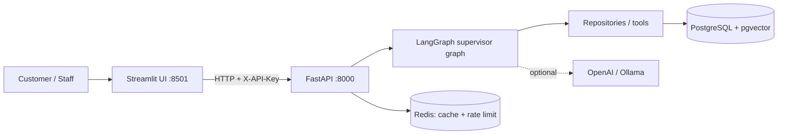
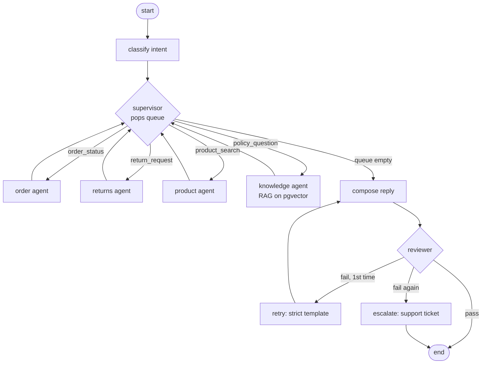

# Architecture & workflows

## System view

## Agent graph

## Design rules (why it is built this way)
1. **Business rules are code, not prompts.** Return eligibility is `services/return_policy.py` (unit-tested).
2. **Agents call repositories, never raw SQL.** Authorization lives there (`get_for_customer`).
3. **No side effect without an explicit ask.** A *question* ("can I return it?") never creates a refund request.
4. **Agents cannot move money.** They can only insert a `pending` row; `/approvals/{id}/decision` is the human gate.
5. **Idempotency.** Re-sending "start the return" reuses the existing pending request.
6. **Reviewer = guardrail.** Blocks "refund issued" claims and order IDs not backed by evidence; bounded retry (1), then escalate.
7. **Works offline.** `LLM_PROVIDER=rules` uses deterministic intent + template replies; an LLM only improves wording.
8. **Everything is audited** (`audit_log`, keyed by `request_id`).

## Data model
`customers` 1-n `orders` 1-n `order_items` n-1 `products` · `approval_requests` · `support_tickets` · `audit_log` · `knowledge_chunks (vector)`

## Redis: what it does here
| Use | Where | Why safe |
|---|---|---|
| Product-search cache (TTL 60 s) | `agents/nodes.py::product_node` | Catalogue data, same for all users |
| Rate limiting | `api/deps.py::rate_limit` | Fixed window per IP; fails open if Redis is down |
| NOT cached | orders, approvals | They change and are per-customer |

Redis is not the source of truth. If it is down, the API falls back to in-memory and keeps working.
